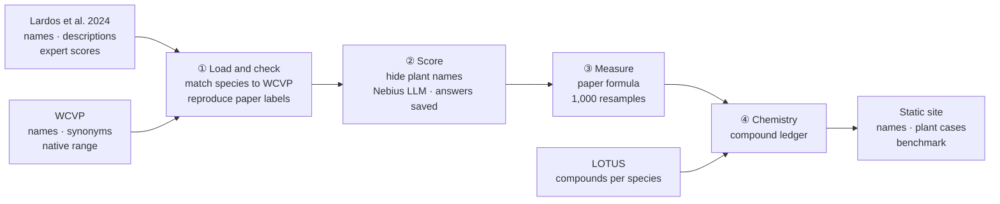

<h1 align="center">Materia Incerta</h1>

**Which plant does a Byzantine drug name refer to, how stable is that answer, and which compounds depend on it?**

<p align="center">
  
  
  
  
  
  
  
  
</p>

<p align="center">
  <b>EthnoHack 2026 · Track 1</b> · Runs end to end on synthetic data · Real Lardos data not loaded yet
</p>

| |
| --- |
| [Demo video](#demo-video) · [The problem](#the-problem) · [What it does](#what-materia-incerta-does) · [How it works](#how-it-works) · [Architecture](#architecture) · [Tech stack](#tech-stack) · [Quickstart](#quickstart) · [Commands](#commands) · [Demo mode](#demo-mode) · [Evaluation](#evaluation) · [Repository layout](#repository-layout) · [Checks](#checks) · [Data and licences](#data-and-licences) · [Troubleshooting](#troubleshooting) · [Scope notes](#honest-scope-notes) |

## Demo video

[**Watch the 90-second pitch and demo**](docs/video/materia-incerta-demo.mp4) (1080p, 13 MB). The model answers in it come from a live Nebius run on Dioscorides' Greek text and *Flora Europaea*, using [`pipeline/examples/alyssos_live.py`](pipeline/examples/alyssos_live.py). The video's source is in [`video/`](video/).

## The problem

A 13th-century pharmacy text names a drug *alyssos*. Which plant is that? Modern readings rest on dictionaries and glossaries that disagree, and a wrong identification sends lab work after the wrong species.

Lardos et al. (2024) replaced dictionary lookups with a systematic test. They compared each botanical detail in Dioscorides' description with modern flora descriptions of every candidate species, then scored the fit. It worked, but every one of the 1,213 comparisons was done by hand, and the result is a single label per candidate with no sense of how fragile it is.

## What Materia Incerta does

For each of the paper's 50 historical names, Materia Incerta produces:

- **A ranked candidate list.** An LLM scores each ancient detail against each modern description, with every plant name hidden. The paper's formula turns the scores into Strong, Moderate or Weak.
- **A stability measure.** The evidence is resampled 1,000 times to show how often each candidate keeps its label and its rank.
- **A compound ledger.** Each candidate is joined to LOTUS, and every compound is marked **robust** (found in all candidates with data), **ID-dependent** (depends on which plant is meant) or **no data**.

For *alyssos*, *Fibigia clypeata* fits Dioscorides' description strongly but has no modern medicinal uses in the sources checked. *Scutellaria galericulata* has the uses but fits weakly. Picking by modern use would favour the worse botanical match. That is the gap this project makes visible.

## How it works

1. **Load.** Read the Lardos files: names, Dioscorides descriptions, suggested candidates and expert scores.
2. **Reconcile.** Map every candidate to a WCVP ID, its synonyms and its native range. From here on, everything joins on IDs, never on plant names.
3. **Check against the paper.** Recompute the paper's labels from its own expert scores. If they don't match, the pipeline stops before any model runs.
4. **Hide the names.** Replace every Greek, Latin and common name for the plant and its candidates with `[PLANT]`, including spelling variants such as *khamaimelon* and *Chamaemelum*. A prompt with a name left in is refused.
5. **Score.** The model classes each detail pair as good, partial, no match or absent. It must quote both texts to claim a match, or the answer counts as absent. Every answer is cached.
6. **Label and resample.** Apply the paper's formula, then resample the feature categories 1,000 times with a fixed seed.
7. **Join chemistry.** Match candidates to LOTUS through WCVP synonyms and build the compound ledger.
8. **Benchmark and export.** Compare model and expert scoring, then write the JSON the site reads.

## Architecture



**Scoring**, exactly as in the paper:

```
match score      good +2 · partial +1 · no match −2 · absent 0
category mean    average match score within each of the 13 feature categories
DoC              categories with a positive mean − categories with a negative mean
label            Strong if DoC ≥ 5 · Moderate if 3 ≤ DoC ≤ 4 · Weak if DoC < 3
```

There is no server. The pipeline computes everything ahead of time, and the site is a static export with no accounts, database or live model calls.

## Tech stack

| Layer | What it is |
| --- | --- |
| **Pipeline** | Python 3.11+ · pandas · NumPy · Pydantic 2 (every table and model response is validated) |
| **Model** | [Nebius Token Factory](https://tokenfactory.nebius.com), tested with Qwen3-235B. Every model answer is saved, so all results can be rebuilt without calling the model again. |
| **Site** | Next.js 16 static export · React 19 · TypeScript 5 (strict) · Tailwind CSS 4 · shadcn/ui-style components |
| **Data** | Lardos et al. 2024 research data · WCVP · LOTUS |
| **Tooling** | pytest · Playwright for screenshots · Vercel for deployment |

## Quickstart

Requires Python 3.11+ and Node 20.9+.

```bash
git clone https://github.com/fozagtx/Materia-Incerta- && cd Materia-Incerta-
python -m venv .venv && source .venv/bin/activate
pip install -e "pipeline[dev]"
npm --prefix client install

python -m materia_incerta demo         # run the whole pipeline on synthetic data
npm --prefix client run dev            # http://localhost:3000
```

With the real data, once the URLs in `pipeline/sources.toml` are filled in:

```bash
python -m materia_incerta download     # fetch Lardos, WCVP and LOTUS into data/raw/
python -m materia_incerta split        # fix the tuning/held-out split, once
export LLM_API_KEY=... LLM_MODEL=Qwen/Qwen3-235B-A22B-Instruct-2507
python -m materia_incerta score --names <lemma>   # score tuning names on Nebius
python -m materia_incerta run --all    # rebuild every result from cached model answers
npm --prefix client run build          # static site in client/out/
```

## Commands

All commands run as `python -m materia_incerta <command>`.

| Command | What it does |
| --- | --- |
| `download` | Fetch the files listed in `pipeline/sources.toml`, checking pinned checksums |
| `run --all` | Run every stage offline. Model scores come only from the cache. |
| `run --stage <name>` | Run selected stages: `ingest`, `reconcile`, `reproduce`, `score`, `aggregate`, `stability`, `chemistry`, `evaluate`, `export` |
| `run --all --strict-cache` | Fail if any scored name is missing a cached model answer |
| `demo` | Build the synthetic dataset, run the pipeline on it and load it into the site |
| `export` | Rewrite the site JSON from the current tables. This also clears demo data. |
| `split` | Assign the 10 tuning and 40 held-out names. Runs once and refuses to overwrite. |
| `score --names a,b` | Live scoring of tuning names on Nebius, into the cache. Needs `LLM_API_KEY` and `LLM_MODEL`. |
| `score --held-out-run --confirm-full-run --reason "..."` | The one held-out run, logged to `pipeline/config/runs.jsonl` |

## Demo mode

Until the Lardos files are in, `python -m materia_incerta demo` builds a small **synthetic** dataset and runs every stage on it:

- 3 names
- 8 candidates
- 13 feature categories
- cached model answers, including one claimed match without a quote, which the evidence rule turns into absent
- a WCVP synonym
- a candidate with no WCVP match
- one with too few LOTUS records

The site shows a red **Synthetic test data** banner while it is loaded. Run `python -m materia_incerta export` to clear it. See [`docs/screenshots/`](docs/screenshots/) for the three pages on demo data.

## Evaluation

Prompts are tuned on 10 names, then judged once on the other 40, split by historical name. No ground truth exists, so every figure is **agreement with published expert scoring**, not accuracy.

| Test | Measure | Baseline | Proposed bar |
| --- | --- | --- | --- |
| Detail matching | Weighted Cohen's kappa over the 1,213 expert comparisons | Always "good" | ≥ 0.6 |
| Invented evidence | Matches claimed on the 405 items experts marked absent | None | < 10% |
| Candidate labels | Exact and within-one-level agreement on 141 candidates | Always "Moderate" | Clearly above baseline |
| Ranking | Top-candidate agreement on the 35 plants with several candidates | Random order | Clearly above baseline |
| Memorisation | Agreement with names hidden against names shown | Masked run | Report the gap |
| Stability | Plants whose top candidate holds in ≥ 80% of resamples | None | Report it |

The bars are fixed before the held-out run. The benchmark page also lists every disagreement, so failures are published alongside successes.

## Repository layout

```
Materia-Incerta-/
├── pipeline/
│   ├── sources.toml               # download manifest: URL, version, sha256, licence
│   ├── src/materia_incerta/
│   │   ├── ingest.py              # Lardos files → clean tables (mapping pending)
│   │   ├── reconcile.py           # species → WCVP IDs, synonyms, native range
│   │   ├── reproduce.py           # recompute paper labels from expert scores
│   │   ├── mask.py                # hide every plant name before scoring
│   │   ├── score.py               # LLM comparison, evidence rule, response cache
│   │   ├── llm.py                 # Nebius adapter (OpenAI-compatible API)
│   │   ├── aggregate.py           # the paper's scoring formula
│   │   ├── stability.py           # 1,000 seeded category resamples
│   │   ├── chemistry.py           # LOTUS join and compound ledger
│   │   ├── evaluate.py            # benchmark tables and the tuning/held-out split
│   │   ├── export.py              # JSON for the site
│   │   ├── run.py · cli.py        # `python -m materia_incerta ...`
│   │   ├── demo.py                # synthetic dataset for tests and the site
│   │   └── config.py · schemas.py # constants, seed, Pydantic models
│   ├── examples/alyssos_live.py   # live model check on real Dioscorides and flora texts
│   └── tests/                     # pytest, on synthetic data only
├── client/
│   ├── app/                       # name index · names/[lemma] · benchmark
│   ├── components/                # candidate table, evidence matrix, ledger, notices
│   └── public/data/               # JSON written by the pipeline
├── data/
│   ├── raw/                       # downloads, never committed
│   ├── interim/                   # generated tables, never committed
│   └── cache/llm/                 # cached model answers
├── video/                         # Remotion source for the pitch video
├── docs/                          # open questions, screenshots, rendered video
├── PRD.md                         # product spec
└── AGENTS.md                      # working rules for contributors and coding agents
```

## Checks

```bash
pytest pipeline/tests                  # scoring, masking, stability, ledger, offline rebuild
npm --prefix client run build          # type-check and build the static site
```

The tests cover:

- reproducing labels from expert scores
- thresholds at their boundaries
- that no name, synonym or transliteration reaches a prompt
- response schema validation
- identical output for the same seed
- the no-data compound case
- a full rebuild with no network and no API key

## Data and licences

| Source | Used for | Licence | On the site |
| --- | --- | --- | --- |
| [Lardos et al. (2024)](https://doi.org/10.1016/j.jep.2023.117622) research data | Names, descriptions, candidates, expert scores | Paper CC BY 4.0; data licence unconfirmed | IDs and scores only, until confirmed |
| [WCVP](https://doi.org/10.1038/s41597-021-00997-6) | Accepted names, synonyms, native range | CC BY 3.0 for v10; confirm for the version used | IDs and range flags |
| [LOTUS](https://doi.org/10.7554/eLife.70780) | Compounds per species, with InChIKey and reference DOI | Confirm on the Zenodo record | Compound IDs, classes and DOIs |
| Beck translation of Dioscorides and two regional floras | Reach the project only inside the Lardos files | Assumed copyrighted | Text withheld |

The Osbaldeston version of Dioscorides is not used.

**References**

- Lardos A. et al. (2024). A systematic methodology to assess the identity of plants in historical texts: A case study based on the Byzantine pharmacy text John the Physician's Therapeutics. *Journal of Ethnopharmacology* 322: 117622. doi:10.1016/j.jep.2023.117622
- Govaerts R. et al. (2021). The World Checklist of Vascular Plants, a continuously updated resource for exploring global plant diversity. *Scientific Data* 8: 215. doi:10.1038/s41597-021-00997-6
- Rutz A. et al. (2022). The LOTUS initiative for open knowledge management in natural products research. *eLife* 11: e70780. doi:10.7554/eLife.70780

## Troubleshooting

**`error: Lardos files not found: lardos_file_02, ...`**
The download URLs in `pipeline/sources.toml` are still blank. Fill them in and run `download`, or put the files under `data/raw/lardos/` by hand.

**`IngestNotReady: ... the column mapping in ingest.py hasn't been written yet`**
The files are present, but nobody has mapped their columns yet. That is build step 1: open the files, write the mapping in `ingest.py`, and check that the paper's labels reproduce for five names.

**`ReproductionFailed: expert-score reproduction failed`**
Labels recomputed from the paper's expert scores don't match the published ones. Fix the ingest mapping or the scoring before any model work. The mismatches are listed in `data/interim/reproduce.json`.

**`ThresholdGapError: DoC 4.5 falls between 4 and 5`**
The paper doesn't say how these values are labelled, so the code refuses to guess. See [docs/open-questions.md](docs/open-questions.md), Q1.

**`error: set LLM_API_KEY and LLM_MODEL to score live`**
Live scoring needs a Nebius API key and a model ID. Copy `.env.example` to `.env`, fill both in, and export them. `run --all` doesn't need them: it uses only cached answers.

**`error: https://api.tokenfactory.nebius.com/v1/chat/completions returned HTTP 401`**
The key is wrong or expired. Rate limits (429) and server errors (5xx) are retried automatically; other errors stop the run.

**The site says "No results exported yet".**
Nothing has been exported. Run `python -m materia_incerta run --all`, or `demo` for synthetic data.

**The site has a red "Synthetic test data" banner.**
Demo data is loaded. Run `python -m materia_incerta export` before committing.

## Honest scope notes

- **Not yet run on real data.** The pipeline, tests and site work end to end on synthetic data only. The Lardos files need downloading and mapping first.
- **No real data scored yet.** Nebius is wired in and was tested live on synthetic data with `Qwen/Qwen3-235B-A22B-Instruct-2507`: 52 calls, all answers schema-valid, rebuilt offline from the cache. The model for the benchmark isn't fixed yet.
- **The true plant may be outside the list.** Only the candidates suggested in the literature are compared. 21 of the 130 taxa are missing from the two regional floras.
- **Compounds are hypotheses.** Every compound result is computational and unvalidated. A compound missing from LOTUS may be unstudied rather than absent. Nothing here is dosing, preparation or treatment advice. Hazardous genera such as *Aristolochia*, *Conium*, *Hyoscyamus* and *Nerium* carry hazard labels.
- **First-rank share is not a probability.** It shows how much the ranking depends on which features are counted, not the chance an identification is correct.
- **Experts stay in charge.** The output supports philologists and botanists; it doesn't replace them.
- **Decisions still open.** These are listed in [docs/open-questions.md](docs/open-questions.md):
  - the rule for values between 4 and 5
  - whether "robust" should need two candidates with data
  - the kappa weights
  - the Eastern Mediterranean area list
